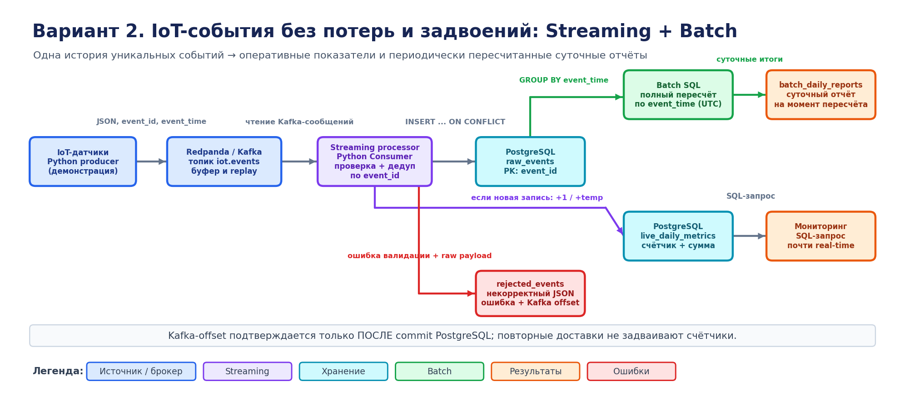

# Отчёт по практической работе №2

**Тема:** проектирование архитектуры данных под задачу. Вариант 2: «Поток событий без потерь (Streaming vs Batch)».

## 1. Вариант и задача

| Поле | Значение |
|---|---|
| ФИО (как в VK Education) | Котяева А.Р. |
| Тема | 2 — Streaming vs Batch |
| Состав решения | IoT-датчики → Kafka-совместимый брокер Redpanda → потоковый Python-потребитель → PostgreSQL (сырые события и оперативные агрегаты) → суточный batch-пересчёт в PostgreSQL → два вида отчётности |
| Данные, объём | События измерения температуры от двух датчиков; в демонстрации 12 сообщений, из них 9 уникальных и 3 намеренных дубля; проектный сценарий: 100 датчиков × 1 событие/мин = 144 000 событий/сутки |

**Постановка задачи.** Датчики отправляют измерения не строго по порядку. Из-за нестабильной сети одно событие может поступить несколько раз либо прийти значительно позже времени измерения. Нужно получать оперативные показатели почти сразу после поступления данных, а также корректные суточные отчёты. При подсчёте событие должно учитываться только один раз, даже если сообщение получено повторно.

**Формат события (пример):**

```json
{
  "event_id": "iot-2026-11-16-01",
  "sensor_id": "sensor_msk_1",
  "event_time": "2026-11-16T08:00:00+00:00",
  "temperature_c": 21.5
}
```

`event_id` — уникальный идентификатор измерения, `event_time` — время самого измерения, `sensor_id` — датчик, `temperature_c` — значение температуры. Дату отчёта определяем по `event_time` в UTC, а не по времени доставки сообщения.

## 2. Источники и способы сбора

| Источник | Тип | Способ сбора и обоснование |
|---|---|---|
| IoT-датчики температуры | Поток | В учебном прототипе имитируются Python-скриптом `producer.py`, отправляющим JSON в брокер. В реальном проекте датчики могут передавать данные через MQTT-шлюз, который публикует их в Kafka. |
| Топик `iot.events` (Redpanda/Kafka API) | Поток | Потребитель последовательно читает сообщения из Kafka. Брокер разделяет поступление и обработку событий, сохраняет журнал на период retention и позволяет повторное чтение. |
| `raw_events` в PostgreSQL | Batch-источник для расчёта | Сохраняем все принятые **уникальные** измерения и пересчитываем суточные метрики SQL-запросом. Повторный расчёт учитывает данные, поступившие позднее. |
| `rejected_events` в PostgreSQL | Ошибочные сообщения | Некорректный JSON/поля записываются вместе с позицией сообщения в Kafka и текстом ошибки, чтобы событие можно было разобрать и повторно загрузить после исправления. |

Выбранные технологии: Redpanda (совместимость с Kafka), Python-потребитель как лёгкий потоковый обработчик, PostgreSQL для хранения и агрегатов. Для более высоких нагрузок можно заменить обработчик на Flink или Spark Structured Streaming, а исторический слой — на Iceberg в Lakehouse. Для небольшой учебной задачи этого пока не требуется.

## 3. Архитектура (draw.io)



**Исходник редактируемой схемы:** [`architecture.drawio`](architecture.drawio).

**Выбор Lambda vs Kappa:** выбран упрощённый подход **Lambda**. Одна ветка быстро обновляет оперативные показатели после каждого уникального события (speed layer), а вторая периодически пересчитывает суточные отчёты по сохранённым сырым данным (batch layer). Таким образом, результаты можно сверять и исправлять без ручного пересчёта отдельных событий. У Kappa меньше дублирования вычислительной логики, так как всё обрабатывается потоком и при необходимости переигрывается из журнала. Но для нашей задачи, где особенно важна проверяемая точность суточных отчётов, отдельный полный batch-пересчёт понятнее.

**Event-time vs processing-time:** используем **event-time**. Например, сообщение с измерением 16 ноября, доставленное 19 ноября, относится к 16 ноября. Время получения `received_at` сохраняется отдельно для мониторинга задержек.

**Дубликаты:** `event_id` является первичным ключом таблицы `raw_events`. Команда `INSERT ... ON CONFLICT DO NOTHING RETURNING` определяет, действительно ли появилось новое событие. Оперативный счётчик обновляется **только для новой записи** и в **той же транзакции**. Поэтому дубли не увеличивают показатели.

**Потери и подтверждения:** потребитель выполняет транзакцию в PostgreSQL, а Kafka-offset подтверждает вручную **после** успешной записи. При сбое до подтверждения Kafka может прислать событие ещё раз, но первичный ключ защитит от повторного учёта. Это доставка *at least once* с идемпотентным эффектом в PostgreSQL, а не сквозная гарантия exactly once для всех возможных отказов оборудования.

**Поздние события:** данные не отбрасываются из-за возраста. Если измерение старше 48 часов, ставится `is_late = true` для диагностики, но оно всё равно записывается в соответствующий день и обновляет оперативный счётчик. Следующий batch-пересчёт скорректирует суточный отчёт. Ограничение в 48 часов — **порог предупреждения, а не watermark для удаления событий**. Отчёт нельзя считать окончательно закрытым, пока источник не гарантировал, что новых событий за этот период не будет.

**Обозначения цветов схемы:** голубой — источник и брокер; фиолетовый — потоковая обработка; бирюзовый — хранение; зелёный — batch; оранжевый — результаты; красный — отклонённые сообщения. Стрелки подписаны назначением передаваемых данных.

## 4. Docker — что поднялось (честно)

| Блок | Статус |
|---|---|
| Redpanda/Kafka broker | Описан в `docker-compose.yml`, **запуск в текущем окружении не проверен** |
| PostgreSQL и SQL-схема | Описаны в `docker-compose.yml` и `sql/init.sql`, **запуск не проверен** |
| Python streaming-потребитель | Реализован в `app/consumer.py`, контейнер описан, **запуск с Kafka/PostgreSQL не проверен** |
| Генератор тестовых событий | Реализован в `app/producer.py`, 12 сообщений / 9 уникальных, **контейнерный запуск не проверен** |
| Суточный batch-пересчёт | Реализован в `app/batch.py`, запускается отдельной командой, **контейнерный запуск не проверен** |
| MQTT-шлюз, распределённый Kafka-кластер, Flink, Lakehouse | Не реализованы; это варианты развития для промышленной нагрузки |

**Причина:** в окружении подготовки отчёта команда `docker` недоступна. Поэтому реальные результаты `docker ps` и логи контейнеров **не выдуманы**. Перед сдачей нужно выполнить команды ниже на компьютере с Docker и при необходимости добавить фактический вывод в отчёт.

**Команды запуска из папки проекта:**

```bash
docker compose up -d --build redpanda postgres processor
docker compose exec redpanda rpk topic create iot.events --partitions 3 --replicas 1 -X brokers=redpanda:9092
docker compose ps

# Генерируем поток (из 12 сообщений только 9 уникальных)
docker compose --profile demo run --rm producer

# Проверяем потоковые агрегаты и отложенные сообщения
docker compose exec postgres psql -U iot -d iot -c \
  "SELECT event_day, sensor_id, events_count, round(temperature_sum / events_count, 2) AS avg_temp FROM live_daily_metrics ORDER BY 1, 2;"
docker compose exec postgres psql -U iot -d iot -c \
  "SELECT count(*) AS unique_events, count(*) FILTER (WHERE is_late) AS late_events FROM raw_events;"

# Полный batch-пересчёт и итоговый суточный отчёт
docker compose --profile manual run --rm batch
docker compose exec postgres psql -U iot -d iot -c \
  "SELECT event_day, sensor_id, events_count, avg_temperature_c FROM batch_daily_reports ORDER BY 1, 2;"

# Фактические контейнеры и лог обработки
docker ps
docker compose logs --tail=30 processor
```

Топик создаётся один раз после первого запуска; при повторном запуске команда создания не нужна.

**Что ожидается при успешном тесте:** в `raw_events` должно оказаться 9 уникальных записей; повторная отправка тех же событий не должна увеличивать количество. Количество уникальных событий по трём датам относительно дня запуска: 4, 3 и 2. Это **ожидаемые результаты по заданному набору**, а не снимок реально запущенного Docker.

Для локального автотеста разбора событий без Docker:

```bash
PYTHONPATH=app python -m unittest discover -s tests -v
```

## 5. Описание пути данных

| Шаг | Для чего | Результат |
|---|---|---|
| 1. Датчик создаёт событие | Измерить температуру и зафиксировать уникальный `event_id` и `event_time` | JSON с измерением |
| 2. Продюсер отправляет в Redpanda | Буферизовать поток и допускать повторное чтение; дождаться подтверждения брокера | Сообщение в `iot.events` |
| 3. Python-потребитель получает сообщение | Проверить JSON, идентификатор, температуру и время | Валидное событие или запись в `rejected_events` |
| 4. Запись в `raw_events` | Сохранить оригинальное измерение без дублей, определить дату по UTC и признак запоздания | Единый слой уникальных данных |
| 5. Обновление `live_daily_metrics` | Сразу скорректировать количество и сумму температур, только если `INSERT` был новым | Оперативные показатели по дню и датчику |
| 6. Подтверждение Kafka-offset | Не пропускать необработанные сообщения; при сбое разрешить безопасную повторную доставку | Устойчивость к перезапуску потребителя |
| 7. Запуск batch | Полностью пересчитать количество и среднюю температуру по `event_time` из `raw_events` | `batch_daily_reports` с учётом поздних событий |
| 8. Пользователь читает отчёт | Видеть оперативную динамику или проверенный суточный результат | Два независимых представления одной группы событий |

**Пример результатов (ожидаемый после одной отправки демонстрационных событий):**

| Дата относительно запуска | Датчик | Уникальные события | Средняя температура, °C |
|---|---|---:|---:|
| D−3 | sensor_msk_1 | 2 | 21,75 |
| D−3 | sensor_msk_2 | 2 | 18,20 |
| D−2 | sensor_msk_1 | 2 | 21,00 |
| D−2 | sensor_msk_2 | 1 | 19,00 |
| D−1 | sensor_msk_1 | 1 | 21,30 |
| D−1 | sensor_msk_2 | 1 | 17,80 |
| **Итого** | **Все датчики** | **9** | — |

Здесь `D` — календарный день, в который запускается генератор (UTC). Порядок доставки намеренно отличается от порядка `event_time`. Повторная отправка всех 12 сообщений не изменит итоговые показатели.

### Дополнительные проектные решения

- **Для учебной демонстрации** используется один брокер Redpanda и одна база PostgreSQL. Это позволяет проверить обработку дублей и повторное чтение, но не защищает от безвозвратной поломки единственного узла.
- **В рабочей системе** нужен кластер из нескольких брокеров, репликация топиков, `acks=all`, резервное копирование PostgreSQL, мониторинг задержек и схема повторной передачи недоставленных событий от источника. Отдельно нужен процесс исправления и повторной обработки `rejected_events`.
- **Граница достоверности:** если датчик вообще не сформировал измерение или данные потерялись до подтверждённой публикации в брокер, этот прототип не сможет восстановить событие. Это решается буферизацией на устройстве/шлюзе и повторными попытками публикации.
- **Для промышленной полноты отчёта** следует определить допустимую задержку, например 48 часов, и публиковать статус отчёта «предварительный/закрытый» с политикой исправления очень поздних событий. Прототип не реализует автоматическую финализацию по watermark и не планирует batch по расписанию.

## 6. Выводы

В работе спроектирована архитектура, которая отдельно решает задачи быстрого мониторинга и точной суточной аналитики. Я выбрала упрощённую Lambda-архитектуру: потоковая обработка быстро обновляет оперативные метрики, а batch позволяет заново проверить итог по всем накопленным событиям.

Ключевые решения — подсчёт даты по `event_time`, сохранение `event_id`, транзакционная дедупликация в PostgreSQL и подтверждение Kafka-offset после записи данных. Они позволяют корректно учитывать повторы и опоздавшие события. При этом учебный прототип не гарантирует абсолютную отказоустойчивость: для промышленной эксплуатации нужны репликация, устойчивый источник, резервные копии и контроль задержек.

### Мой любимый десерт

Чизкейк. *Это пример текста для обязательного раздела: при необходимости замени на свой любимый десерт.*

---

**Перед сдачей:** проверить, что написание ФИО совпадает с VK Education; выполнить Docker-команды на компьютере и добавить реальный вывод `docker ps`; загрузить в свой GitHub-репозиторий как минимум `отчет.md`, `architecture.drawio` и `architecture.png`.
